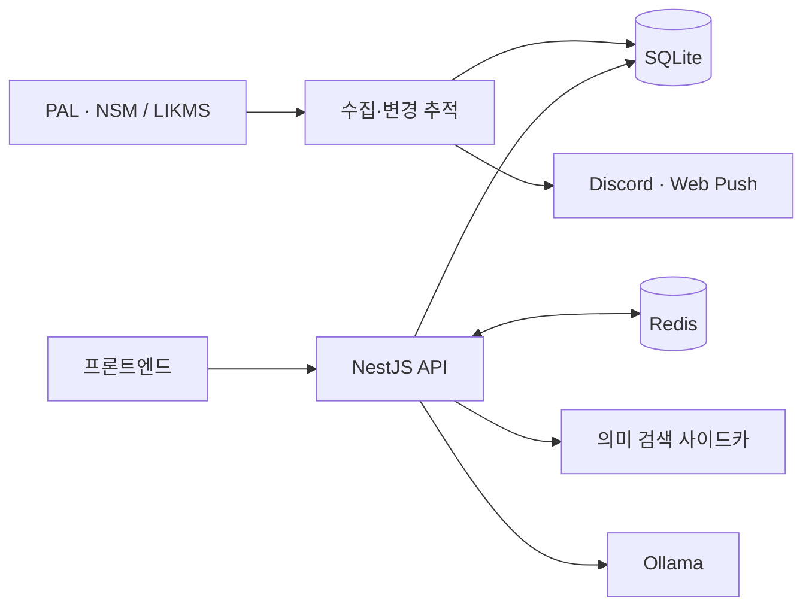

# LawCast Backend

국회 법률안 정보를 수집하고 검색·변경 이력·토론·알림 API를 제공하는 NestJS 서버입니다. SQLite에 아카이브와 변경 기록을 저장하고 Redis를 캐시와 작업 큐에 사용합니다. 주요 기술은 NestJS 11, TypeORM, SQLite FTS5, Redis, `pal-crawl`입니다.

## 주요 기능과 구성

- 국회 입법예고(PAL)와 발의·계류 단계 법률안을 정기 수집합니다. NSM 수집 경로는 국민참여입법센터 또는 국회 의안정보시스템(LIKMS)을 선택할 수 있습니다.
- 원문·HTTP 메타데이터·스크린샷을 아카이브하고 주요 정보의 변경을 append-only 해시 체인으로 기록합니다. 법률안별 변경 이력과 과거 리비전 조회, 무결성 감사, ZIP 내보내기를 지원합니다.
- 키워드 검색은 제목·제안자·위원회·제안이유를 조회하며 제안이유에는 FTS5를 사용합니다. 의미 검색은 별도 Python 사이드카를 호출합니다.
- 익명 토론, Discord 웹훅·Web Push 알림, Ollama 요약을 제공합니다. Notion 관리자 공지, Discord 운영 브리지, file.kiwi 미러는 선택 기능입니다.



## 설치와 실행

Node.js는 [.node-version](.node-version)의 `24.22.1`을 권장합니다. 지원 범위는 [package.json](package.json)의 `engines`를 따릅니다. npm과 Redis가 필요하며 수집에는 Puppeteer가 실행할 Chromium과 운영체제 라이브러리가 필요합니다. Linux 컨테이너 구성은 [Dockerfile](Dockerfile)을 참고하세요.

아래 명령은 별도 안내가 없으면 `backend/`에서 실행합니다.

```bash
cd backend
npm ci
cp .env.example .env
```

`.env`에서 DB·Redis 경로와 사용할 선택 기능을 확인합니다. 로컬 Redis의 기본 포트는 `6379`입니다. 루트 Compose의 Redis에 호스트에서 접속한다면 `REDIS_URL=redis://localhost:6399`로 바꿉니다.

```env
PORT=3001
NODE_ENV=development
DATABASE_PATH=lawcast.db
REDIS_URL=redis://localhost:6379
FRONTEND_URL=http://localhost:5173
CRON_TIMEZONE=Asia/Seoul
OLLAMA_ENABLED=false
SEMANTIC_SEARCH_ENABLED=false
```

Ollama와 의미 검색 엔진을 따로 실행하지 않는 개발 환경은 위처럼 두 기능을 꺼도 됩니다. 토론을 사용할 때는 아래의 참여자 식별용 비밀값도 설정해야 합니다.

```bash
npm run start:dev
```

기본 API 주소는 `http://localhost:3001/api`입니다. 서버는 시작할 때 미적용 마이그레이션을 실행하고 활성화된 크롤러의 수집·예약 작업도 시작합니다. 기존 DB를 사용할 때는 백업과 경로를 먼저 확인하세요.

프로덕션 빌드와 실행은 다음과 같습니다.

```bash
npm run build
npm run start:prod
```

### Swagger와 Bruno 로컬 테스트

로컬 Redis를 실행한 뒤 아래 명령을 실행합니다. 기존 `.env` 대신 별도 SQLite 파일
(`.local-openapi/runtime/lawcast.db`)과 Redis 키 접두사를 사용합니다. 국회 계류안 수집은
동작하지만 Discord, Web Push, Ollama, 의미 검색은 기본으로 꺼져 있습니다.

```bash
npm run start:openapi
```

- Swagger UI: [http://127.0.0.1:3091/docs](http://127.0.0.1:3091/docs)
- OpenAPI JSON: [http://127.0.0.1:3091/openapi.json](http://127.0.0.1:3091/openapi.json)
- Bruno에서 **Import collection → URL**을 선택하고 OpenAPI JSON 주소를 입력합니다.
  **Check for Spec Updates**를 켜면 가져온 컬렉션에서 명세 변경을 확인할 수 있습니다.
  가져온 뒤 환경을 **로컬 개발 서버**로 선택하고 `GET /api/version`, `GET /api/health`,
  `GET /api/notices/archive`를 보내 연결을 확인합니다.

일반 개발 서버에 문서만 추가하려면 `OPENAPI_ENABLED=true npm run start:dev`를 사용합니다.
문서는 `NODE_ENV=development`이면서 `OPENAPI_ENABLED=true`일 때만 열리며, 이때
서버는 `127.0.0.1`에서만 요청을 받습니다. 문서의 서버 주소는 실행 포트를 따릅니다.
환경에 따라 테스트용 법안 번호나 요청 본문을 채워야 합니다. 웹훅 등록 및 구독은 기존
작업증명 검증을, 토론 수정·삭제는 기존 비밀번호 검증을 그대로 사용합니다.

### 의미 검색 지연 시간 확인

백엔드를 `npm run start:dev`로 실행하고 `SEMANTIC_SEARCH_ENABLED=true`와
`SEMANTIC_SEARCH_API_URL`을 설정합니다. 프런트엔드도 `npm run dev`로 실행하고
`PUBLIC_SEMANTIC_SEARCH_ENABLED=true`, `API_BASE_URL=http://localhost:3001/api`를 지정한 뒤 의미 검색을 실행합니다.

- 화면의 **Search Timing**에서 SvelteKit의 응답 본문 처리까지 걸린 시간, 백엔드의 응답 헤더 전송까지 걸린 시간, 사이드카 호출별 왕복 및 단계별 시간을 확인합니다. 브라우저 렌더링은 포함하지 않습니다.
- 개발 백엔드는 유효한 UUID의 `x-lawcast-search-trace`를 받은 검색 요청에만 `x-lawcast-search-timing` 응답 헤더(JSON, 캐시 금지)를 보냅니다. `traceId`, `backendMs`, `sidecarCalls`(최대 12건), `omittedCalls`를 반환합니다. 각 호출에는 백엔드 요청 시작 기준의 `startMs`, 경로, 상태, 왕복 시간과 가능한 경우 청크 수 및 `denseMs`, `annotateMs`, `totalMs`가 포함됩니다. 단위는 모두 밀리초입니다.
- 지원되는 사이드카의 `denseStages`(질의 임베딩, FAISS 조회·정렬, 관련도 분류)도 전달합니다. 4 KiB 헤더 한도에 맞추기 위해 일부 호출이 생략될 수 있으며, 생략 수는 `omittedCalls`에 기록됩니다.
- 백엔드 터미널에서는 같은 `traceId`로 응답 종료까지의 백엔드 시간과 전체 호출 내역을 확인할 수 있습니다. 구버전 사이드카나 실패한 호출에는 단계별 시간이 없을 수 있습니다.

전용 의미 검색과 공고 목록의 자동·의미 검색을 추적합니다. 각 시간은 서로 중첩되므로 합산하지 않습니다. 공개 API 응답 형식은 그대로입니다.

## 설정

전체 템플릿은 [.env.example](.env.example), 실제 기본값과 스케줄은 [src/config/app.config.ts](src/config/app.config.ts)에서 확인합니다. `.env`와 템플릿의 값은 코드 기본값과 다를 수 있습니다.

### 기본 연결과 수집

- `DATABASE_PATH`: SQLite 파일 경로. 기본 `lawcast.db`이며 상대 경로는 `backend/` 기준으로 해석합니다.
- `REDIS_URL`: 기본 `redis://localhost:6379`. `REDIS_KEY_PREFIX`와 `REDIS_TTL`로 네임스페이스와 기본 캐시 수명을 설정합니다.
- `FRONTEND_URL`: CORS 허용 주소. 여러 주소는 쉼표로 구분하며 기본값은 `http://localhost:5173`입니다.
- `CRON_TIMEZONE`: 예약 작업 시간대. 기본 `Asia/Seoul`입니다.
- `CRAWLING_PAL_ENABLED`, `CRAWLING_NSM_ENABLED`: 소스별 수집 여부. 기본은 모두 활성화이며, 둘 다 끄면 시작이 실패합니다.
- `CRAWLING_NSM_SOURCE`: 기본 `nsm`; `likms`로 설정하면 국회 의안정보시스템을 사용합니다. LIKMS 경로에서는 NSM 포털에 의존하는 소스 삭제 감지가 꺼집니다.

### 토론과 알림

토론에는 `DISCUSSION_AUTHOR_ID_SECRET`이 필요합니다. `DISCUSSION_IP_SALT`도 운영 환경별 값으로 설정하세요. 비밀값은 각각 `openssl rand -hex 32` 등으로 생성해 `.env`에 저장하고 저장소에 올리지 않습니다.

토론은 비밀번호 해시로 수정·삭제 권한을 확인합니다. 참여자 식별자는 원본 IP와 스레드 범위의 HMAC으로 만들며 화면에는 마스킹한 접속 정보를 표시합니다. 같은 IP라도 스레드가 달라지면 식별자가 달라집니다. 역방향 프록시는 실제 방문자 IP를 정확히 전달하도록 설정해야 합니다.

브라우저 알림은 `WEB_PUSH_ENABLED=true`와 VAPID 공개키·비밀키가 모두 있어야 활성화됩니다.

```bash
npx web-push generate-vapid-keys
```

생성한 키를 `WEB_PUSH_VAPID_PUBLIC_KEY`, `WEB_PUSH_VAPID_PRIVATE_KEY`에 넣고 `WEB_PUSH_SUBJECT`를 설정합니다. 웹훅 등록의 작업증명 검증은 `HASHGUARD_API_URL`과 `HASHGUARD_API_KEY` 설정을 확인하세요.

### AI 요약과 의미 검색

Ollama 요약은 `OLLAMA_ENABLED=true`, `OLLAMA_API_URL`, `OLLAMA_MODEL`로 설정합니다. `OLLAMA_ENABLED`를 생략하면 URL과 모델이 모두 있을 때 켜집니다. `OLLAMA_TIMEOUT`은 생성 요청, `OLLAMA_HEALTH_TIMEOUT_MS`는 상태 확인 요청의 제한 시간이며 기본값은 각각 `10000`, `2000`밀리초입니다. CPU 처리량 조절은 `OLLAMA_CPU_MODE`와 `ARCHIVE_SYNC_*` 설정을 사용합니다.

의미 검색은 `SEMANTIC_SEARCH_ENABLED`(기본 `true`)와 `SEMANTIC_SEARCH_API_URL`(기본 `http://127.0.0.1:8300`)로 연결합니다. [의미 검색 README](https://github.com/vientofactory/semantic-search/blob/main/README.md)에 인덱스 구축과 사이드카 실행 방법이 있습니다.

- `SEMANTIC_SEARCH_TIMEOUT`: 사이드카 개별 요청 제한 시간. 기본 `10000`밀리초입니다.
- `SEMANTIC_SEARCH_TOTAL_TIMEOUT`: 검색의 청크 창 수집 전체 예산. 기본값은 개별 요청 제한 시간과 같습니다.
- `SEMANTIC_SEARCH_HYBRID_MAX_NOTICES`: 아카이브 의미 검색의 공고 후보 상한. 기본 `100`이며 전체 코퍼스를 빠짐없이 조회하는 검색은 아닙니다.

엔진 비활성·연결 실패 등에는 검색을 키워드로 대체합니다. 유효한 의미 검색 결과가 빈 배열인 경우는 그대로 반환하며 사이드카의 잘못된 요청에 대한 4xx 응답도 키워드 결과로 숨기지 않습니다. 엔진 상태 조회 실패는 `503`으로 전달합니다.

### 기타 선택 기능

- `NOTION_API_KEY`, `NOTION_DATABASE_ID`: 관리자 공지 읽기. 공지 작성과 공개 여부 관리는 Notion에서 합니다.
- `DISCORD_BRIDGE_ENABLED`: Discord 운영 명령과 로그 연동. 봇 토큰·채널·관리자 ID 설정을 함께 확인합니다.
- `FILE_MIRROR_DUMP_TIMEOUT_MS`: SQLite 덤프 자식 프로세스 실행 제한(ms). 기본값은 30분이며 업로드 시간은 포함하지 않습니다.
- `FILE_MIRROR_ENABLED`: 민감 테이블을 제외한 SQLite 미러 업로드. 업로드 주기와 보존 옵션은 템플릿과 설정 코드에서 확인합니다.

## API 사용

기본 경로는 `/api`입니다. 대표적인 읽기 요청은 다음과 같습니다.

```bash
curl http://localhost:3001/api/health
curl --get http://localhost:3001/api/notices/archive \
  --data-urlencode 'search=세입자 보호' \
  --data-urlencode 'searchMode=keyword' \
  --data-urlencode 'limit=10'
curl http://localhost:3001/api/notices/2210001/detail
```

- 입법예고: `GET /api/notices/recent`, `/api/notices/archive`, `/api/notices/search`, `/api/notices/semantic-search`.
- 상세·기록: `GET /api/notices/:num/detail`, `/api/notices/:num/changes`, `/api/notices/:num/screenshot`, `/api/notices/:num/export`; 전체 변경 목록은 `/api/notices/changes`입니다.
- 토론: `/api/notices/:num/discussions`, `/api/discussions/threads`, `/api/discussions/threads/:threadId/comments` 등에서 목록·생성·의견 작성 기능을 제공합니다.
- 알림: `POST /api/webhooks`, `GET /api/push/public-key`, `POST`·`DELETE /api/push/subscriptions`.
- 운영: `GET /api/health`, `/api/stats`, `/api/batch/status`, `/api/crawling-transparency`, `/api/version`. 홈용 경량 통계는 `/api/stats?view=home`입니다.
- 관리자 공지: `GET /api/announcements`, `/api/announcements/top`.

아카이브의 `searchMode`는 미지정 시 `keyword`이며 `auto`, `semantic`을 명시하면 의미 검색 경로를 사용합니다. 검색 엔진의 후보 상한과 관련도에 따라 의미 검색 결과가 키워드 검색보다 적을 수 있습니다. 프론트엔드의 검색 기본값과는 구분하세요.

법률안별 변경 이력은 `limit`과 `beforeHeight` 커서를 사용합니다. 다음 페이지에는 응답의 `nextBeforeHeight`를 전달하며 `hasMore=false`이면 마지막 페이지입니다.

조회·쓰기 API에는 요청 제한이 있으며 초과 시 `429`를 반환합니다. 검색어·페이지 크기·필터의 범위는 엔드포인트마다 다릅니다. 전체 경로와 입력 계약은 [API 컨트롤러](src/controllers/api.controller.ts), [의미 검색 컨트롤러](src/modules/semantic-search/semantic-search.controller.ts), [토론 컨트롤러](src/modules/discussions/controllers/discussions.controller.ts)에서 확인합니다.

## 검사와 테스트

```bash
npm run lint
npx tsc --noEmit
npm run build
npm test
```

`lint`는 ESLint 자동 수정을 포함합니다. 커버리지는 `npm run test:cov`, API E2E는 `npm run test:e2e`로 실행합니다. 저장소 루트에서는 `python3 tools/check-agent-guidelines.py`도 확인합니다.

## Docker와 운영

루트 Compose를 사용하려면 `backend/.env`를 준비한 뒤 저장소 루트에서 실행합니다.

```bash
docker compose up -d --build backend
curl http://127.0.0.1:3001/api/health
```

Compose는 백엔드와 함께 Redis·Ollama 의존 서비스를 시작합니다. SQLite는 `lawcast_db` 볼륨의 `/app/data/lawcast.db`에 저장하고, 컨테이너 연결 주소는 `redis:6379`, `ollama:11434`, `semantic-search:8300`으로 덮어씁니다. 백엔드의 호스트 포트는 `127.0.0.1:3001`에만 바인딩됩니다. 의미 검색 서비스는 별도로 준비해야 합니다.

운영 배포는 루트 저장소의 서브모듈 포인터를 갱신하면 CI를 거쳐 실행됩니다. 수집·종료 상태 갱신·무결성 감사 등은 예약 작업이며, 현재 실행 상태는 `/api/batch/status`와 `/api/crawling-transparency`에서 확인합니다. 상세 시간표는 설정 코드가 관리하므로 README에 중복하지 않습니다.

## 코드 구조

- `src/controllers/`: HTTP API.
- `src/modules/`: 수집·아카이브·캐시·검색·토론·알림 등 도메인 기능.
- `src/config/`: 환경변수 해석, 기본값과 스케줄.
- `src/migrations/`: SQLite 스키마 마이그레이션.
- `src/utils/`: 공통 유틸리티.

## 라이선스

MIT

### 변경기록 전체 감사의 프로세스 격리

일일·주간 감사와 초기 동기화 후 감사는 DB 덤프와 마찬가지로 별도 자식 프로세스에서 수행합니다. 메인 프로세스의 SQLite 연결을 재사용하지 않으며, 자식은 읽기 전용 연결과 단일 읽기 스냅샷으로 이벤트·상세·아카이브를 일관되게 확인합니다. 해시 생성 함수는 변경기록 저장 경로와 공유합니다. 메인 스레드로 되돌아가서 감사를 실행하는 폴백은 없습니다.

기본 예산은 실행시간 30분, V8 old-space 192 MiB, RSS 512 MiB, 작업/휴식 비율 목표 25%입니다. `CHAIN_AUDIT_TIMEOUT_MS`, `CHAIN_AUDIT_HEAP_MB`, `CHAIN_AUDIT_RSS_MB`, `CHAIN_AUDIT_DUTY_PERCENT`, `CHAIN_AUDIT_BATCH_SIZE`로 조정하며 허용 상한은 코드에서 제한합니다. 아카이브 시드는 기본 50건씩, 상세 조회는 이벤트 ID 500개씩 나눕니다. SQLite 페이지 캐시는 8 MiB로 제한하고 mmap을 사용하지 않습니다. 법안·상세 배치 및 이벤트 25건마다 휴식하므로 CPU와 읽기 요청이 연속적으로 몰리는 것을 줄입니다. OS가 허용하면 프로세스 우선순위도 낮춥니다.

작업/휴식 비율은 협력적 제어이며 커널 CPU·디스크 대역폭 쿼터는 아닙니다. RSS 검사는 작업 구간 사이에 수행하며, Linux에서는 부모가 250ms마다 `/proc`도 확인하여 네이티브 SQLite 실행 중 초과를 감지합니다. 검사 사이의 일시적 초과는 가능합니다. 엄격한 CPU·메모리·I/O 상한이 필요하면 배포 환경에서 별도 cgroup이 추가로 필요합니다. 제한 초과·자식 비정상 종료는 감사 실패로 처리하고, 메인 서비스 종료 시에도 자식 종료를 기다립니다. 긴 읽기 스냅샷은 WAL 정리를 지연시킬 수 있어 실행시간 상한을 유지해야 합니다.

모든 법안과 이벤트를 검사하고 실패 총수 및 체크포인트 해시를 유지하되, 대규모 손상 시 부모 IPC와 로그가 커지지 않도록 반환하는 `failures` 상세는 앞의 100건으로 제한합니다. `failureCount`가 `failures.length`보다 클 수 있습니다. 기존 API 응답·저장된 변경기록·정규화 버전은 바꾸지 않습니다. 동시 전체 감사는 한 개만 허용하며 중복 요청은 오류로 반환합니다.

### 자식 프로세스 개발·검증

DB 덤프(`database-dump-child.ts`)와 전체 변경기록 감사(`chain-audit-child.ts`)는 모두 일반 TypeScript 소스입니다. 전용 CJS 자산 복사나 별도 JS 타입 검사 프로젝트를 사용하지 않습니다.

- `npm run lint`: 두 프로세스를 포함한 공통 TypeScript ESLint/Prettier 검사·수정
- `npm run format`: 공통 `src/**/*.ts` Prettier 포맷
- `npm run check`: 같은 프로젝트에 대한 TypeScript API 컴파일러와 native 컴파일러의 타입 검사
- `npm run build`: 위 타입 검사 후 Nest 빌드로 두 프로세스의 `.js`를 생성

공통 실행 유틸리티는 빌드된 `.js`를 우선 사용합니다. 소스 기반 테스트에서는 동일한 빌드 설정의 `ts-node` 로더를 사용하지만, 운영 이미지에서는 `ts-node` 없이 빌드된 `.js`만 실행합니다. 부모 환경은 필요한 임시 경로·시간대만 전달하고 기존 힙 제한·IPC·취소·타임아웃 동작을 유지합니다.
